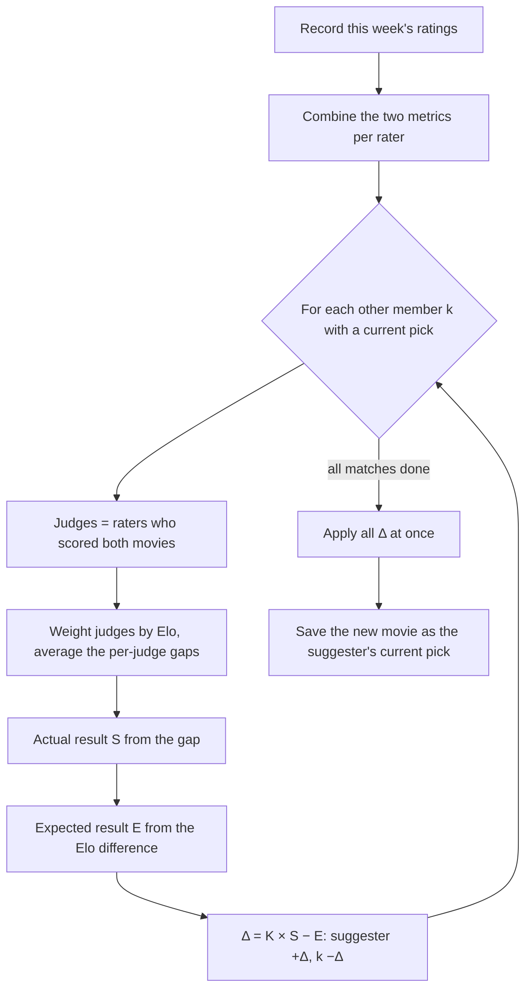

# Movie Night Elo

`movie_elo` is a dependency-free Python package that ranks the members of a movie club with real Elo mechanics. One person picks each week, everyone else rates the movie on two scales, and ratings from higher-rated members carry more weight.

This document is both the **guide to the algorithm** (sections 1–7) and the **API reference** for the package (sections 8–12).

---

## Contents

1. [The game this is built for](#1-the-game-this-is-built-for)
2. [The mental model: a league of picks](#2-the-mental-model-a-league-of-picks)
3. [The math](#3-the-math)
4. [Parameters](#4-parameters)
5. [Worked example](#5-worked-example)
6. [Edge cases](#6-edge-cases)
7. [FAQ](#7-faq)
8. [Installation and quick start](#8-installation-and-quick-start)
9. [API reference](#9-api-reference)
10. [Persistence](#10-persistence)
11. [Guarantees, and a checklist for porting](#11-guarantees-and-a-checklist-for-porting)
12. [Development](#12-development)

---

## 1. The game this is built for

- A group of `n` members. Designed for 5 or 6; works for any `n ≥ 3`.
- Each week one member (the **suggester**) proposes three movies. The others vote and the group watches the winner.
- Afterwards, everyone except the suggester rates the movie on two 1–10 scales: **viewing experience** and **movie quality**.
- All ratings are recorded and kept. The system needs the raw numbers from every past week.

---

## 2. The mental model: a league of picks

Think of each member's **most recent pick** as their player on the field.

- Every week, the new movie plays one **match** against each other member's current pick.
- Each match is decided by **judges**: the people who rated *both* movies. This automatically excludes the two suggesters involved.
- Each judge compares the two movies on their own scale. Judges' opinions are averaged with weights that grow with the judge's Elo.
- The weighted comparison becomes a soft result between 0 and 1, like a win probability. It is compared against the Elo-predicted result, and the difference moves points from one member to the other, exactly as in chess Elo.
- Your pick keeps **defending** your rating every week until you pick again.



Consequences of this shape:

- The total Elo in the group never changes, so 1500 is always the group average and nothing drifts.
- There is no need to agree on what rating counts as "average." Only comparisons between movies matter.
- A harsh rater and a generous rater contribute only their *preference*, because each judge's bias is the same for both movies they compare.
- Nobody's own rating is ever used in a match that involves their own pick.

---

## 3. The math

### 3.1 Notation

| Symbol | Meaning |
|---|---|
| `R_x` | Elo of member `x` at the **start** of the week |
| `s` | this week's suggester |
| `k` | an opponent: any other member who has a current pick |
| `e_j`, `q_j` | rater `j`'s viewing-experience and movie-quality scores (1–10) |
| `c_j(M)` | rater `j`'s combined score for movie `M` |
| `K`, `D`, `W`, `α` | tunable parameters (section 4) |

### 3.2 Step 1 — combine the two metrics

For every rater `j` of the new movie:

```
c_j(new) = α · e_j + (1 − α) · q_j
```

With `α = 0.5` this is a plain average. The package stores the raw `e_j` and `q_j` and recomputes `c_j` whenever it is needed, so `α` can be changed later.

### 3.3 Step 2 — find the judges for each match

For the match between `s`'s new movie and `k`'s current pick:

```
judges = { j : j rated the new movie  AND  j rated k's current pick }
```

`s` never rates their own movie and `k` never rated theirs, so neither appears in the judge set. Absent members drop out automatically.

### 3.4 Step 3 — judge weights

```
w_j = 2 ^ ((R_j − 1500) / W)
```

Then normalise within the match so the weights sum to 1:

```
ŵ_j = w_j / Σ w_i   (sum over the judges of this match)
```

Normalising per match matters because different matches have different judge sets. With `W = 400`, a judge 400 points above another counts twice as much; 200 points above counts about 1.4× as much.

### 3.5 Step 4 — the weighted gap

Each judge's verdict is how much higher they scored the new movie than `k`'s pick. Average those verdicts with the normalised weights:

```
gap = Σ ŵ_j · ( c_j(new) − c_j(k's pick) )
```

A positive gap means the judges preferred the new movie. The per-judge difference is taken first and then averaged. Averaging each movie separately over its own full rater set and subtracting would be wrong, because the two rater sets differ.

### 3.6 Step 5 — actual result

Convert the gap to a soft result in `(0, 1)`:

```
S = 1 / (1 + 10 ^ (−gap / D))
```

`gap = 0` is a draw (`S = 0.5`). With `D = 2`, a 1-point gap gives `S ≈ 0.76` and a 2-point gap gives `S ≈ 0.91`.

### 3.7 Step 6 — expected result

Standard Elo formula, using start-of-week ratings:

```
E = 1 / (1 + 10 ^ ((R_k − R_s) / 400))
```

If `s` is rated 200 points above `k`, `E ≈ 0.76`: `s` is expected to produce a clearly better movie just to break even.

### 3.8 Step 7 — transfer

```
Δ = K · (S − E)
R_s  += Δ
R_k  −= Δ
```

### 3.9 Finish the week

1. Compute **every** match with the start-of-week Elo snapshot. Nobody is updated between matches.
2. Sum the deltas and apply them all at once.
3. Save the new movie's ratings as `s`'s current pick, replacing the old one.

The suggester accumulates up to `n − 1` deltas on their own week; each opponent gets exactly one.

---

## 4. Parameters

All parameters live on the `Params` object (section 9.1). Defaults are tuned for a 1–10 scale and 5–6 members.

### Core

| Field | Meaning | Default | Notes |
|---|---|---|---|
| `start` | Initial Elo for everyone | 1500 | Also the permanent group mean |
| `k` | Maximum points moved per match | 32 | 24 is calmer, 48 converges faster |
| `d` | Score gap that maps to a ~91% result | 2.0 | In rating-scale units; lower it if you use a smaller scale |
| `w` | Elo points that double a judge's weight | 400 | 200 for a much stronger "high Elo matters more" effect |
| `alpha` | Weight on viewing experience vs. movie quality | 0.5 | 1.0 = experience only, 0.0 = quality only |
| `scale_min`, `scale_max` | Allowed range of a raw rating | 1, 10 | Ratings outside the range are rejected |

### Optional extensions (off by default)

| Field | Meaning | Default |
|---|---|---|
| `voter_share` | Fraction of the suggester's weekly delta split equally among members who voted for the chosen movie | 0.0 |
| `provisional_picks` | A member's first N picks are played at `k_provisional`; a match is provisional if *either* side is | 0 |
| `k_provisional` | K used for provisional matches | same as `k` |
| `max_pick_age` | A pick stops defending after this many recorded weeks | `None` (never) |

### Reference values with the defaults

| Gap (points) | `S` | | Elo difference | `E` | | Elo above 1500 | Judge weight |
|---|---|---|---|---|---|---|---|
| 0.0 | 0.50 | | 0 | 0.50 | | −200 | 0.71 |
| 0.5 | 0.64 | | 50 | 0.57 | | −100 | 0.84 |
| 1.0 | 0.76 | | 100 | 0.64 | | 0 | 1.00 |
| 1.5 | 0.85 | | 200 | 0.76 | | +100 | 1.19 |
| 2.0 | 0.91 | | 300 | 0.85 | | +200 | 1.41 |
| 3.0 | 0.97 | | 400 | 0.91 | | +400 | 2.00 |

Scale of movement with `k = 32`, `n = 6`: the suggester's theoretical maximum swing in one week is `k · (n − 1) = 160`; a very strong week is typically +60 to +90. A defender moves at most `k = 32` in a week. A pick that is consistently better than everyone else's gathers roughly +150 over a full rotation.

Because the raw ratings are kept, any parameter can be changed later by replaying the log (section 10).

---

## 5. Worked example

Five members, mid-season: A 1700, B 1550, C 1500, D 1400, E 1350 (total 7500).

E suggests this week. Combined scores (`alpha = 0.5`) from the four raters:

| Rater | Experience | Quality | Combined |
|---|---|---|---|
| A | 8 | 7 | 7.5 |
| B | 7 | 6 | 6.5 |
| C | 9 | 8 | 8.5 |
| D | 6 | 7 | 6.5 |

Each other member's current pick, with combined scores from its raters:

| Pick | A | B | C | D | E |
|---|---|---|---|---|---|
| A's | — | 7.0 | 6.0 | 8.0 | 7.5 |
| B's | 5.5 | — | 6.5 | 6.0 | 7.0 |
| C's | 8.5 | 8.0 | — | 8.5 | 7.5 |
| D's | 5.5 | 6.0 | 5.5 | — | 6.5 |

**Match E vs. A in full.** Judges are B, C, D (A and E are excluded).

| Judge | Elo | Raw weight `2^((R−1500)/400)` | Normalised | New − A's pick |
|---|---|---|---|---|
| B | 1550 | 1.091 | 0.372 | 6.5 − 7.0 = −0.5 |
| C | 1500 | 1.000 | 0.341 | 8.5 − 6.0 = +2.5 |
| D | 1400 | 0.841 | 0.287 | 6.5 − 8.0 = −1.5 |

- `gap = 0.372·(−0.5) + 0.341·(2.5) + 0.287·(−1.5) = +0.237`
- `S = 1 / (1 + 10^(−0.237/2)) = 0.568`
- `E = 1 / (1 + 10^((1700 − 1350)/400)) = 0.118`
- `Δ = 32 · (0.568 − 0.118) = +14.4` → E gains 14.4, A loses 14.4

E only narrowly beat A's pick, but because E was expected to lose badly, the gain is substantial. That is the Elo handicap working.

**All four matches:**

| Match | Judges | Gap | `S` | `E` | Δ for E |
|---|---|---|---|---|---|
| vs A | B, C, D | +0.24 | 0.57 | 0.12 | +14.4 |
| vs B | A, C, D | +1.61 | 0.87 | 0.24 | +20.0 |
| vs C | A, B, D | −1.41 | 0.16 | 0.30 | −4.2 |
| vs D | A, B, C | +1.82 | 0.89 | 0.43 | +14.8 |

**Result:** E +44.9 → 1395. A −14.4 → 1686, B −20.0 → 1530, C +4.2 → 1504, D −14.8 → 1385. Total is still 7500.

A's weight (1.41) made A's verdict count about 70% more than D's (0.84) in the three matches they both judged.

This example is encoded as a test (`tests/test_league.py::WorkedExampleTests`), and `format_week_report` prints exactly these numbers.

---

## 6. Edge cases

| Situation | Behaviour |
|---|---|
| A member missed a movie and did not rate it | They are not a judge in any match involving that movie. Nothing else changes. |
| Nobody rated both movies in a match | The match is skipped and reported in `WeekResult.skipped` as `"no common judges"`. |
| The suggester was absent or no movie was watched | Do not record a week. |
| Someone skips their turn | Their old pick keeps defending. Set `max_pick_age` if you want very old picks to retire; skipped matches are reported as `"stale pick"`. |
| A new member joins | `League.add_member` at 1500. They can judge right away and enter the league on their first pick. The group mean stays at 1500. |
| A member leaves | `League.remove_member`. By default the rest are re-centred so the mean returns to 1500; this changes nothing in any future computation. Their past ratings stay inside other members' picks, but they can no longer judge. |
| Exact tie in a match | `gap = 0`, `S = 0.5`. A draw. |
| Only 3 members | Works, with one judge per match. Expect noisy results; consider `k = 24`. |
| 2 members | Does not work: there are no neutral judges. |
| Double feature | Record as two separate weeks with the same suggester. |
| Half-point ratings (7.5) | Allowed; validation only enforces the scale range. |
| A rating outside the scale, an unknown member, the suggester rating or voting, an empty week, a repeated `week_id` | Rejected with a `ValidationError` subclass before anything changes. |

---

## 7. FAQ

**Why did my Elo change on a week I did not pick?**
Your most recent pick was challenged by the new movie and lost (or won). Your pick defends your rating until you pick again.

**My movie scored higher than theirs, so why did I gain so little?**
You were rated well above them, so the system expected you to win. You gain a lot by beating higher-rated members and very little by beating lower-rated ones.

**Why zero-sum?**
It keeps 1500 as the group average forever, removes drift, and removes the need to decide what rating counts as "average."

**Why compare per judge instead of averaging each movie's score?**
If one member rates everything 8–9 and another rates everything 5–7, that difference cancels when each judge compares two movies they both saw. Only their preference remains.

**Can we change the parameters mid-season?**
Yes. Replay the log with new `Params`. Everyone's numbers will shift, so agree on it as a group.

**Can someone game it by rating low?**
Your rating is never used in a match that involves your own pick. Rating the suggester low transfers points from them to everyone else, which lifts the others relative to you as much as it lowers the suggester. There is no clean way to help yourself.

**How much should Elo spread out?**
With defaults and 5–6 members, expect a spread of roughly ±150 to ±250 around 1500 after a year. If it feels too flat, raise `k` or lower `d`; if it swings too much, do the opposite.

---

## 8. Installation and quick start

The package has no dependencies and supports Python 3.9+.

```bash
pip install .            # from this directory
# or vendor the movie_elo/ folder into your application
```

Minimal use:

```python
from movie_elo import League, Week, format_week_report, format_standings

league = League(["Alex", "Bea", "Chris", "Dana", "Eve"])

result = league.play_week(Week(
    week_id="2026-11-14",
    suggester="Eve",
    movie="Example Title",
    ratings={"Alex": (8, 7), "Bea": (7, 6), "Chris": (9, 8), "Dana": (6, 7)},
))

print(format_week_report(result))
print(format_standings(league))
```

Recommended shape for a real application: keep an append-only log of `Week` records plus the member list and `Params`, and derive standings with `replay` (section 10).

---

## 9. API reference

Everything below is importable from `movie_elo`.

```
movie_elo/
  params.py     Params
  models.py     Rating, Week, Pick, JudgeVerdict, MatchResult, WeekResult, Standing
  formulas.py   combined_score, judge_weight, normalize, actual_score, expected_score
  league.py     League, replay
  report.py     format_week_report, format_standings
  storage.py    log/snapshot JSON helpers
  errors.py     MovieEloError, ValidationError, UnknownMemberError, DuplicateWeekError
```

All data types are frozen dataclasses with `to_dict()` and, where it makes sense, `from_dict()`. Dictionaries are plain JSON-serialisable Python.

### 9.1 `Params`

```python
Params(k=32.0, d=2.0, w=400.0, alpha=0.5, start=1500.0,
       scale_min=1.0, scale_max=10.0,
       voter_share=0.0, provisional_picks=0, k_provisional=None, max_pick_age=None)
```

Immutable. Every field is validated on construction (`ValidationError` on bad values: non-positive `k`/`d`/`w`, `alpha` outside `[0, 1]`, `scale_min ≥ scale_max`, `voter_share` outside `[0, 1)`, negative `provisional_picks`, non-positive `k_provisional`, `max_pick_age < 1`). See section 4 for the meaning of each field.

| Member | Description |
|---|---|
| `effective_k_provisional` | `k_provisional` if set, otherwise `k` |
| `to_dict()` | plain dict of all fields |
| `Params.from_dict(d)` | inverse; unknown keys raise `ValidationError` |

### 9.2 `Rating`

```python
Rating(experience: float, quality: float)
```

| Member | Description |
|---|---|
| `Rating.coerce(value)` | Accepts a `Rating`, an `(experience, quality)` pair, or a mapping with those keys. Used everywhere ratings are accepted, so callers may pass plain tuples. |
| `to_dict()` | `{"experience": ..., "quality": ...}` |

### 9.3 `Week`

```python
Week(week_id: str, suggester: str, movie: str,
     ratings: Mapping[str, Rating | tuple | mapping],
     candidates: tuple[str, ...] = (), votes: Mapping[str, str] = {}, date: str | None = None)
```

One recorded movie night. `ratings` maps rater → rating; values are coerced with `Rating.coerce`. `candidates` and `votes` (voter → candidate title) are optional and only used by the voter-credit extension. Structural validation happens on construction: non-empty ids, `movie` must be one of `candidates` when candidates are given, votes must be for candidates. Membership and range validation happens when the week is played, because that depends on the league.

| Member | Description |
|---|---|
| `raters` | tuple of rater names |
| `voters_for_movie()` | members whose vote matched `movie` |
| `to_dict()` / `Week.from_dict(d)` | JSON round trip; optional fields are omitted when empty |

### 9.4 `League`

```python
League(members: Iterable[str] = (), params: Params | None = None)
```

Holds member Elo, each member's current `Pick`, pick counts, the set of processed week ids, the week index, and the full `WeekResult` history.

**Read-only views**

| Member | Returns |
|---|---|
| `params` | the `Params` in use |
| `members` | tuple of names in insertion order |
| `elo` | `{member: elo}` copy |
| `picks` | `{member: Pick}` copy of current picks |
| `pick_counts` | `{member: int}` for all members (0 if none yet) |
| `history` | tuple of `WeekResult`, oldest first |
| `processed_weeks` | tuple of week ids in processing order |
| `week_count` | number of weeks processed (the current week index) |
| `rating(member)` | one member's Elo; `UnknownMemberError` if absent |
| `total_elo()` | sum of all Elo; equals `start × len(members)` unless seeded manually |
| `standings()` | list of `Standing`, ranked by Elo (ties broken by name) |

**Membership**

| Method | Description |
|---|---|
| `add_member(name, elo=None)` | Adds a member at `params.start`, or at `elo` to seed an existing state (this moves the group mean). Duplicate names raise `ValidationError`. |
| `remove_member(name, recenter=True)` | Removes the member and their current pick. With `recenter`, every remaining member is shifted by the same constant so the mean returns to `start`. The shift has no effect on any later computation. |

**Playing**

| Method | Description |
|---|---|
| `preview_week(week) -> WeekResult` | Validates and computes the week without changing the league. Use for "what if" displays or to show the group what a rating would do. |
| `play_week(week) -> WeekResult` | Validates, computes, applies the deltas, records the suggester's new pick, appends to history. Atomic: if validation fails nothing changes. |

Validation performed by both methods, each raising a `ValidationError` subclass: duplicate `week_id` (`DuplicateWeekError`); unknown suggester, rater or voter (`UnknownMemberError`); suggester among the raters or voters; no ratings; any rating outside `[scale_min, scale_max]`.

**Serialisation**

| Method | Description |
|---|---|
| `to_dict()` | Full snapshot: `version`, `params`, `members`, `elo`, `picks`, `pick_counts`, `processed_weeks`, `week_index`, `history`. JSON-serialisable. |
| `League.from_dict(d)` | Inverse. Rejects unknown `version`. Also the supported way to seed a league from a known mid-season state. |

### 9.5 `replay`

```python
replay(members: Iterable[str], weeks: Iterable[Week], params: Params | None = None) -> League
```

Builds a fresh `League` and plays every week in order. Deterministic: the same log always yields the same league. This is the recommended way to compute standings from stored data and to re-tune parameters.

### 9.6 Result and state types

**`WeekResult`** — the auditable outcome of one week.

| Field / property | Description |
|---|---|
| `week_id`, `suggester`, `movie` | identifies the week |
| `matches` | tuple of `MatchResult`, one per opponent that had a match |
| `skipped` | `{opponent: reason}` for opponents without a match: `"no common judges"` or `"stale pick"` |
| `voter_credit` | `{voter: delta}` from the voter-credit extension; empty when off |
| `deltas` | `{member: delta}` actually applied (includes voter credit); members with zero change are omitted |
| `elo_before`, `elo_after` | `{member: elo}` snapshots for every member |
| `match_total` | the suggester's delta from matches alone, before voter credit |
| `suggester_delta` | the suggester's final applied delta |
| `to_dict()` / `from_dict()` | JSON round trip |

**`MatchResult`** — the new movie versus one opponent's pick.

| Field | Description |
|---|---|
| `opponent`, `opponent_movie` | who and what was challenged |
| `judges` | tuple of `JudgeVerdict`; weights sum to 1 |
| `gap` | weighted mean of per-judge gaps (new − old) |
| `actual` | `S` |
| `expected` | `E` for the suggester |
| `k` | K used for this match (differs from `params.k` only under the provisional rule) |
| `delta` | added to the suggester, subtracted from the opponent |

**`JudgeVerdict`** — `judge`, `weight` (normalised), `new_score`, `old_score`, and the `gap` property (`new_score − old_score`).

**`Pick`** — a member's current pick: `member`, `movie`, `week_id`, `ratings` (raw `Rating` per rater), `number` (1-based ordinal among the member's picks), `made_at` (week index when recorded; age in a later week is `week_count − made_at`).

**`Standing`** — one leaderboard row: `rank`, `member`, `elo`, `pick_count`, `current_movie` (`None` before the first pick).

### 9.7 Formulas

Stateless functions, exposed for custom displays, spreadsheets, or ports.

| Function | Description |
|---|---|
| `combined_score(rating, alpha)` | `alpha·experience + (1−alpha)·quality` |
| `judge_weight(elo, start, w)` | `2 ** ((elo − start) / w)` |
| `normalize(weights)` | scale a `{key: weight}` mapping to sum to 1 |
| `actual_score(gap, d)` | `1 / (1 + 10 ** (−gap / d))` |
| `expected_score(elo_a, elo_b)` | `1 / (1 + 10 ** ((elo_b − elo_a) / 400))` |

### 9.8 Reporting

| Function | Description |
|---|---|
| `format_week_report(result, precision=1)` | Multi-line text: each match with judges, gap, `S`, `E`, `K`, `Δ`; skipped opponents; voter credit; every member's change with before → after. |
| `format_standings(league_or_rows, precision=0)` | Fixed-width leaderboard table. Accepts a `League` or a list of `Standing`. |

### 9.9 Storage

JSON helpers in `movie_elo.storage`. Paths may be `str` or `pathlib.Path`.

| Function | Description |
|---|---|
| `log_to_dict(members, weeks, params=None)` | `{"version": 1, "members": [...], "params": {...}, "weeks": [...]}` |
| `log_from_dict(d) -> (members, weeks, params)` | inverse; checks `version` |
| `save_log(path, members, weeks, params=None)` / `load_log(path)` | file versions of the above |
| `replay_log(path, params=None) -> League` | load a log and replay it; `params` overrides the stored ones |
| `save_league(path, league)` / `load_league(path)` | write/read a `League.to_dict()` snapshot |

### 9.10 Exceptions

```
MovieEloError
└── ValidationError (also a ValueError)
    ├── UnknownMemberError
    └── DuplicateWeekError
```

Catch `ValidationError` to handle every bad-input case in one place.

---

## 10. Persistence

The **week log is the source of truth**; standings are derived data. Store three things: the member list, the `Params`, and the ordered list of weeks with raw ratings. Rebuild with `replay` or `replay_log`. This makes the system auditable, lets you re-tune parameters without losing anything, and keeps the stored data independent of the library version.

Log file format (`save_log`):

```json
{
  "version": 1,
  "members": ["Alex", "Bea", "Chris", "Dana", "Eve"],
  "params": {"k": 32.0, "d": 2.0, "w": 400.0, "alpha": 0.5, "start": 1500.0,
             "scale_min": 1.0, "scale_max": 10.0, "voter_share": 0.0,
             "provisional_picks": 0, "k_provisional": null, "max_pick_age": null},
  "weeks": [
    {
      "week_id": "2026-11-14",
      "suggester": "Eve",
      "movie": "Example Title",
      "ratings": {
        "Alex":  {"experience": 8, "quality": 7},
        "Bea":   {"experience": 7, "quality": 6},
        "Chris": {"experience": 9, "quality": 8},
        "Dana":  {"experience": 6, "quality": 7}
      },
      "candidates": ["Example Title", "Other One", "Other Two"],
      "votes": {"Alex": "Example Title", "Bea": "Other One", "Chris": "Example Title", "Dana": "Other Two"},
      "date": "2026-11-14"
    }
  ]
}
```

`candidates`, `votes` and `date` are optional.

Membership changes over time are not part of the log format. If your group changes, either keep the full historical member list in `members` (removed members simply stop appearing in weeks) or persist a `League` snapshot with `save_league` after each change. Snapshots are a convenience; a snapshot plus the subsequent weeks can always be replayed forward.

Store raw scores, never only the combined or weighted numbers. Weights change every week as Elo changes, and you may want to change `alpha` or `w` later.

---

## 11. Guarantees, and a checklist for porting

The package guarantees the following. If you port the algorithm to another language or a spreadsheet, check every item; each one is a mistake that quietly produces wrong numbers.

1. **Elo is snapshotted at the start of the week.** Every expected result and every judge weight in a week uses that snapshot. Updating between matches would make the result depend on processing order. (Tested: reversing the opponent order gives identical deltas.)
2. **All deltas are applied at once** after every match is computed.
3. **Judges are the intersection** of the two rater sets. Neither suggester ever judges, and nobody judges a match involving their own pick.
4. **Per-judge differences are computed first, then weighted.** Averaging each movie over its own rater set and subtracting is wrong.
5. **Judge weights are normalised per match**, because judge sets differ between matches.
6. **Sign convention:** `gap = new − old`; `S > 0.5` means the new movie was preferred; `E` is the suggester's expectation; `Δ` is added to the suggester and subtracted from the opponent.
7. **Conservation:** the Elo total equals `start × members` after every week (unless seeded with custom Elo). Assert it in your own tests.
8. **Week 1 is a no-op.** There are no opponents and no placeholder movie is invented.
9. **Matches with zero judges are skipped**, never scored as a draw.
10. **The suggester's pick is replaced after** the matches are computed, and a pick is never compared with itself.
11. **Duplicate `week_id`s are rejected.**
12. **Raw ratings are stored**; combined scores are recomputed on demand.
13. **Full floating-point precision** is kept internally; rounding happens only in the report functions.
14. **Inputs are validated before any state changes:** known members, suggester not rating or voting, scores within the scale.
15. **Replay is deterministic:** the same log produces the same league, and equals incremental play.

---

## 12. Development

Layout:

```
movie-night-elo/
  README.md
  pyproject.toml
  movie_elo/           the package
  tests/               unittest suite (also runs under pytest)
    helpers.py         shared fixtures, including the worked example state
    test_formulas.py
    test_league.py
    test_extensions.py
    test_serialization.py
```

Run the tests from the project root:

```bash
python -m unittest discover -s tests
# or
pytest
```

The suite covers the worked example, order independence, conservation, judge selection, absences, validation, membership changes, every extension, JSON round trips, and the report renderers.

## Beli-style rankings (experimental, independent library)

A separate pure-Python package, `movie_beli`, ranks movies in the style of the Beli app: a member picks a bucket (Liked / Fine / Didn't like), answers a few "which did you like more?" questions, and gets a 0–10 score per movie, a community score, and a leaderboard of members by the scores their recommendations receive. It is a stateless library with no UI: the host app (the hosted page lives in [reel-club](https://github.com/hansonhqma/reel-club)) stores the ranking JSON and the in-progress comparison state itself. It does not use or change `movie_elo`. Spec and integration notes: [docs/beli-rankings.md](docs/beli-rankings.md).

```python
from movie_beli import Insertion, Rankings, PREFER_NEW

r = Rankings(["Alex", "Bea"]); r.submit_movie("Heat", "Alex"); r.submit_movie("Drive", "Alex")
r.rank_movie("Bea", "Heat", "liked", ask=lambda new, old: PREFER_NEW)   # answers come from a callable...
state = r.start_ranking("Bea", "Drive", "liked")                        # ...or one step at a time:
state = Insertion.from_dict(state.to_dict()).answer(PREFER_NEW)         # store state.to_dict() between requests
r.finish_ranking(state); data = r.to_dict()                              # [row.to_dict() for row in r.leaderboard()]
```
